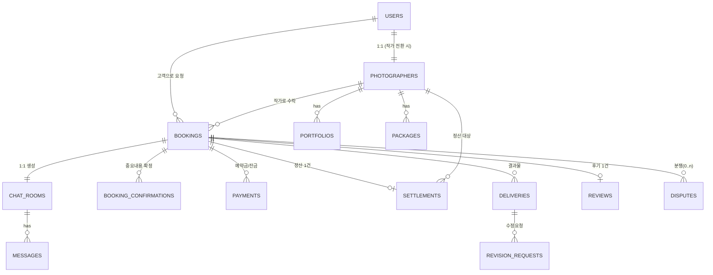

# 씬파인더(SceneFinder) — DB 스키마 & API 명세 (MVP, v0.1)

> 초기 설계 초안입니다. 현재 정책은 PRD v0.3을 기준으로 하며 승인된 사업자·프리랜서 작가 모두 유료 활동이 가능합니다. 프리랜서 원천징수액을 별도로 기록·정산하는 스키마는 아직 구현되지 않았으므로 실결제 정산 전에 보완해야 합니다.

---

## 1. ERD 개요



---

## 2. 테이블 정의

### 2-1. `users` (공통 회원)
| 컬럼 | 타입 | 설명 |
|---|---|---|
| id | uuid PK | |
| role | enum('customer','photographer','admin') | |
| name | varchar | |
| phone | varchar | 본인인증 완료 값 |
| email | varchar unique | |
| phone_verified_at | timestamp | |
| status | enum('active','suspended','withdrawn') | |
| created_at / updated_at | timestamp | |

### 2-2. `photographers` (작가 확장 정보)
| 컬럼 | 타입 | 설명 |
|---|---|---|
| id | uuid PK | |
| user_id | uuid FK → users.id | |
| photographer_type | enum('business','freelancer') | 작가 유형. 승인된 두 유형 모두 유료 활동 가능 |
| business_reg_no | varchar nullable | 사업자등록번호 — 사업자 작가만 필수 |
| business_name | varchar nullable | 상호 — 사업자 작가만 필수 |
| representative_name | varchar nullable | 대표자명 — 사업자 작가만 필수 |
| settlement_account | varchar | 정산계좌 — 유형 무관 필수 (현재 저장값 암호화 미구현) |
| settlement_account_holder | varchar | 예금주 확인값 |
| active_regions | varchar[] | 활동 지역 |
| mood_tags | varchar[] | 분위기 태그 |
| categories | varchar[] | 전문 촬영 분야 |
| verification_status | enum('pending','verified','rejected') | 관리자 심사 상태 |
| is_new_photographer | boolean | 정산 유보 특례 대상 여부(첫 3건) |
| completed_bookings_count | int | |
| avg_rating | decimal | |
| response_time_avg_min | int | |
| created_at | timestamp | |

### 2-3. `shoot_categories` (촬영 분야 — 확장 가능한 설정 테이블)
| 컬럼 | 타입 | 설명 |
|---|---|---|
| id | uuid PK | |
| code | varchar unique | 예: 'event','family','couple','travel','sports','profile','brand','senior_tour' |
| label | varchar | 화면 노출용 한글명 (예: "시니어 투어") |
| is_active | boolean | 노출 여부 — 관리자가 신규 카테고리를 코드 배포 없이 추가/비활성화 가능 |
| sort_order | int | |

⚠️ 촬영 종류(네비게이터 1단계)·포트폴리오 카테고리 모두 하드코딩 enum이 아닌 이 테이블을 참조하도록 설계 — "시니어 투어" 같은 신규 분야를 DB row 추가만으로 확장 가능하게 함.

### 2-4. `portfolios`
| 컬럼 | 타입 | 설명 |
|---|---|---|
| id | uuid PK | |
| photographer_id | uuid FK | |
| category_id | uuid FK → shoot_categories.id | (기존 고정 enum에서 변경) |
| image_url | varchar | |
| sort_order | int | |

### 2-5. `packages` (촬영 상품)
| 컬럼 | 타입 | 설명 |
|---|---|---|
| id | uuid PK | |
| photographer_id | uuid FK | |
| title | varchar | 예: "행사 베이직" |
| category | varchar | |
| duration_min | int | |
| base_price | int | |
| included_photos | int | |
| retouch_scope | text | |
| raw_included | boolean | |
| delivery_days | int | |
| options | jsonb | 추가옵션(시간연장/2인배치/드론 등) 가격 목록 |

### 2-6. `bookings` (예약/촬영계약)
| 컬럼 | 타입 | 설명 |
|---|---|---|
| id | uuid PK | |
| customer_id | uuid FK → users.id | |
| photographer_id | uuid FK | |
| package_id | uuid FK nullable | 맞춤 견적인 경우 null |
| status | enum('inquiry','quoted','held','deposit_paid','confirmed','completed','delivered','closed','cancelled','disputed') | |
| shoot_category_id | uuid FK → shoot_categories.id | 촬영종류(행사/가족/시니어 투어 등, 확장형) |
| shoot_datetime | timestamp | |
| location | varchar | |
| headcount | int | |
| purpose | varchar | |
| required_scenes | jsonb | 필수 촬영 장면 |
| total_amount | int | |
| deposit_amount | int | 총액의 30% |
| balance_amount | int | |
| hold_expires_at | timestamp | 슬롯 홀드 만료(견적확정 +1시간) |
| balance_due_at | timestamp | 촬영일 -3일 |
| created_at / updated_at | timestamp | |

### 2-7. `booking_confirmations` (소통방 내 중요내용 확정 기록)
| 컬럼 | 타입 | 설명 |
|---|---|---|
| id | uuid PK | |
| booking_id | uuid FK | |
| field | varchar | 예: shoot_datetime, location, amount, delivery_date |
| value | text | |
| confirmed_by_customer_at | timestamp | |
| confirmed_by_photographer_at | timestamp | |

### 2-8. `chat_rooms` / `messages`
| chat_rooms | | |
|---|---|---|
| id | uuid PK | |
| booking_id | uuid FK unique | 예약 1건당 1개 |
| contact_disclosed | boolean | 예약금 결제 후 true |

| messages | | |
|---|---|---|
| id | uuid PK | |
| chat_room_id | uuid FK | |
| sender_id | uuid FK | |
| type | enum('text','image','file','location','system') | |
| content | text | |
| pii_flag | boolean | 개인정보 포함 자동감지 시 true |
| created_at | timestamp | |

### 2-9. `payments`
| 컬럼 | 타입 | 설명 |
|---|---|---|
| id | uuid PK | |
| booking_id | uuid FK | |
| type | enum('deposit','balance','refund') | |
| amount | int | |
| pg_provider | varchar | 'tosspayments' |
| pg_transaction_id | varchar | |
| status | enum('pending','completed','cancelled','expired','failed') | |
| paid_at | timestamp | |
| webhook_payload | jsonb | 원본 웹훅 저장(대사용) |

### 2-10. `cancellations` (취소·환불 산정 기록)
| 컬럼 | 타입 | 설명 |
|---|---|---|
| id | uuid PK | |
| booking_id | uuid FK | |
| initiated_by | enum('customer','photographer','platform') | |
| fault | enum('customer','photographer','force_majeure') | |
| rule_applied | varchar | 예: 'D-7이전 전액환불', '당일 10%+실비' |
| refund_amount | int | |
| compensation_amount | int | 작가 귀책 시 고객 보상액(10%) |
| actual_cost_items | jsonb | 실비 항목(대관료 등) 및 증빙 |
| created_at | timestamp | |

### 2-11. `settlements` / `settlement_items`
| settlements | | |
|---|---|---|
| id | uuid PK | |
| photographer_id | uuid FK | |
| period_start / period_end | date | 주 단위 정산 구간 |
| status | enum('scheduled','held','paid') | |
| held_reason | varchar nullable | 분쟁 진행중인 booking_id 참조 |
| total_amount | int | |
| paid_at | timestamp | |

| settlement_items | | |
|---|---|---|
| id | uuid PK | |
| settlement_id | uuid FK | |
| booking_id | uuid FK | |
| gross_amount | int | 고객 결제금액 |
| platform_fee | int | 15~20% |
| pg_fee | int | |
| deduction_amount | int | 작가 귀책 환불·보상·차지백 상계액 |
| net_amount | int | 현재 구현의 최종 지급액. 원천징수액은 별도 기록하지 않음 |
| withholding_tax_amount | int (추가 필요) | 법령상 원천징수 대상인 경우 세액 기록. 라이브 프리랜서 정산 전에 스키마·계산·명세서 반영 필요 |

### 2-12. `deliveries` / `revision_requests`
| deliveries | | |
|---|---|---|
| id | uuid PK | |
| booking_id | uuid FK | |
| photo_urls | jsonb | 클라우드 스토리지 경로 |
| representative_photo_urls | jsonb | |
| delivered_at | timestamp | |
| download_expires_at | timestamp | 납품 +30일 |
| customer_confirmed_at | timestamp | 미확인 시 +7일 자동확인 |

| revision_requests | | |
|---|---|---|
| id | uuid PK | |
| delivery_id | uuid FK | |
| photo_ref | varchar | 사진 번호 |
| request_type | enum('skin','brightness_color','crop','background','glare','detail') | |
| description | text | |
| status | enum('requested','in_progress','done') | |

### 2-13. `reviews`
| 컬럼 | 타입 | 설명 |
|---|---|---|
| id | uuid PK | |
| booking_id | uuid FK unique | 결제·촬영 완료 건만 작성 가능 |
| rating_overall / rating_kindness / rating_punctual / rating_communication / rating_speed | int(1~5) | |
| will_reuse | boolean | |
| category | varchar | 표시용(행사/아이/외국인/여행동행) |
| content | text | |

### 2-14. `disputes`
| 컬럼 | 타입 | 설명 |
|---|---|---|
| id | uuid PK | |
| booking_id | uuid FK | |
| raised_by | enum('customer','photographer') | |
| type | enum('quality','noshow','delay','other') | |
| status | enum('open','fact_check_requested','resolved','escalated') | |
| photographer_response_due_at | timestamp | 요청 접수 +24시간 |
| resolution | text | |
| resolved_at | timestamp | |

### 2-15. `consents` (초상권/미성년자 동의)
| 컬럼 | 타입 | 설명 |
|---|---|---|
| id | uuid PK | |
| booking_id | uuid FK | |
| type | enum('portfolio_full','portfolio_partial','portfolio_face_hidden','portfolio_none') | |
| minor_included | boolean | |
| guardian_consent_at | timestamp nullable | 미성년 포함 시 필수 |

### 2-16. `favorites` (찜한 작가)
| 컬럼 | 타입 | 설명 |
|---|---|---|
| id | uuid PK | |
| customer_id | uuid FK → users.id | |
| photographer_id | uuid FK | |
| created_at | timestamp | |

unique(customer_id, photographer_id)

---

## 3. API 명세 (MVP)

### 3-1. 인증/회원
| Method | Endpoint | 설명 |
|---|---|---|
| POST | /api/auth/signup | 회원가입 (role: customer/photographer) |
| POST | /api/auth/login | |
| POST | /api/auth/phone-verify | 휴대전화 본인인증 |
| GET | /api/users/me | 내 정보 조회 |
| PATCH | /api/users/me | 정보 수정 |
| DELETE | /api/users/me | 탈퇴(약관 제7조 — 채권채무 존속 처리) |

### 3-2. 작가 온보딩
| Method | Endpoint | 설명 |
|---|---|---|
| POST | /api/photographers/apply | 작가 지원 신청 |
| POST | /api/photographers/business-verification | 사업자등록 인증 요청 |
| GET | /api/photographers/{id}/verification-status | |
| POST | /api/photographers/{id}/portfolios | 포트폴리오 등록 |
| POST | /api/photographers/{id}/packages | 촬영 상품 등록 |
| PATCH | /api/photographers/{id}/schedule | 가능 일정 갱신 |

### 3-3. 네비게이터 / 검색
| Method | Endpoint | 설명 |
|---|---|---|
| POST | /api/navigator/recommendations | 촬영종류·상황·분위기·조건 → 추천 작가 목록 (적합도 스코어) |
| GET | /api/photographers?category=&region=&date= | 조건 검색 |
| GET | /api/photographers/{id} | 프로필 상세 |

### 3-4. 예약 / 견적
| Method | Endpoint | 설명 |
|---|---|---|
| POST | /api/bookings | 예약 문의 생성 → status=inquiry, chat_room 자동 생성 |
| POST | /api/bookings/{id}/quote | 작가 견적 제시 → status=quoted, hold_expires_at 설정 |
| POST | /api/bookings/{id}/accept-quote | 고객 견적 수락 |
| GET | /api/bookings/{id} | |
| GET | /api/bookings?role=customer\|photographer&status= | 목록 |
| POST | /api/bookings/{id}/confirmations | 중요내용 확정(양측 서명형) |
| POST | /api/bookings/{id}/reschedule-request | 일정 변경 요청 |
| POST | /api/bookings/{id}/reschedule-response | 승인/거절 |

### 3-5. 소통방
| Method | Endpoint | 설명 |
|---|---|---|
| GET | /api/bookings/{id}/messages | |
| POST | /api/bookings/{id}/messages | 메시지 전송(텍스트/이미지/파일/위치) — 서버단 PII 필터 적용 |
| GET | /api/bookings/{id}/contact | 예약금 결제 후에만 200, 이전엔 403 |

### 3-6. 결제
| Method | Endpoint | 설명 |
|---|---|---|
| POST | /api/bookings/{id}/payments/deposit | 예약금 결제 요청(토스페이먼츠 연동) |
| POST | /api/bookings/{id}/payments/balance | 잔금 결제 요청 |
| POST | /api/webhooks/tosspayments | 결제완료/취소/만료 웹훅 수신 |
| GET | /api/bookings/{id}/payments | 결제 내역 |

### 3-7. 취소/환불
| Method | Endpoint | 설명 |
|---|---|---|
| POST | /api/bookings/{id}/cancel | 취소 요청(귀책·시점 기준 자동 산정) |
| GET | /api/bookings/{id}/cancellation-preview | 예상 환불/위약금 미리보기 |
| POST | /api/bookings/{id}/cancel/actual-costs | 작가 귀책 취소 시 실비 증빙 첨부 |

### 3-8. 촬영완료 / 결과물
| Method | Endpoint | 설명 |
|---|---|---|
| POST | /api/bookings/{id}/complete | 작가가 촬영완료 처리 |
| POST | /api/bookings/{id}/deliveries | 사진 업로드(클라우드 스토리지 경로) |
| POST | /api/deliveries/{id}/confirm | 고객 납품 확인 |
| POST | /api/deliveries/{id}/revision-requests | 수정 요청 |
| PATCH | /api/revision-requests/{id} | 상태 갱신 |
| GET | /api/customers/me/deliveries | **마이페이지 "받은 사진"** — 내 예약 전체의 납품 갤러리 목록(대표사진, 만료일 포함) |

### 3-9. 후기
| Method | Endpoint | 설명 |
|---|---|---|
| POST | /api/bookings/{id}/review | 결제·촬영 완료 건만 허용 |
| GET | /api/photographers/{id}/reviews?category= | |

### 3-10. 분쟁/고객센터
| Method | Endpoint | 설명 |
|---|---|---|
| POST | /api/bookings/{id}/disputes | **분쟁 신고 화면에서 호출** — 유형·상세내용·증빙 첨부, 접수 시 해당 booking 정산 자동 보류 |
| GET | /api/bookings/{id}/disputes | 해당 예약의 분쟁 진행 상태 조회(접수→사실확인요청→조정→해결) |
| POST | /api/disputes/{id}/fact-check-request | 작가에게 사실확인 요청(24h SLA) |
| POST | /api/disputes/{id}/resolve | 관리자 조정 결과 반영 |
| POST | /api/support/tickets | 일반 문의 |
| POST | /api/support/emergency | 긴급 문의(전날/당일) |

### 3-11. 찜하기
| Method | Endpoint | 설명 |
|---|---|---|
| POST | /api/favorites | { photographer_id } — 프로필/추천결과 화면 하트 아이콘에서 호출 |
| DELETE | /api/favorites/{photographer_id} | |
| GET | /api/customers/me/favorites | 마이페이지 "찜한 작가" 목록 |

### 3-12. 정적/법적 페이지
| Method | Endpoint | 설명 |
|---|---|---|
| GET | /api/pages/{slug} | slug: how-to-use, about, terms-of-service, photographer-terms, privacy-policy, cancellation-policy, intermediary-notice — CMS 없이 마크다운 렌더링으로 시작 가능 |
### 3-13. 정산 (작가)
| Method | Endpoint | 설명 |
|---|---|---|
| GET | /api/photographers/{id}/settlements | 정산 내역 |
| GET | /api/photographers/{id}/settlements/{sid}/items | 건별 상세(수수료/보상금/차감 내역) |
| POST | /api/admin/settlements/run-weekly | 배치: 주 1회 정산 실행 |

### 3-14. 관리자
| Method | Endpoint | 설명 |
|---|---|---|
| GET | /api/admin/dashboard | 신규 고객/작가, 대기, 지연, 분쟁 등 요약 |
| POST | /api/admin/photographers/{id}/approve | |
| POST | /api/admin/photographers/{id}/suspend | |
| POST | /api/admin/payments/{id}/refund | 부분 환불 등 수동 처리 |
| POST | /api/admin/reviews/{id}/blind | 후기 블라인드 |

---

## 4. 상태 전이 (bookings.status)

```
inquiry → quoted → held(슬롯 홀드) → deposit_paid → confirmed
       → completed → delivered → closed
(각 단계에서 → cancelled / disputed 분기 가능)
```

---

## 5. 배치/스케줄 작업
| 작업 | 주기 |
|---|---|
| 슬롯 홀드 만료 해제 | 1분마다 |
| 잔금 미결제 알림(D-3) | 매일 |
| 납품 후 미확인 자동확인 처리(+7일) | 매일 |
| 주간 정산 실행 | 주 1회(요일 지정) |
| 다운로드 만료 알림(-7일) / 자동 삭제 | 매일 |

---

*본 문서는 MVP 범위 기준 초안이며, 실제 개발 착수 전 인증 방식(JWT/세션), 파일 스토리지 벤더, 결제 웹훅 재시도 정책 등 인프라 세부사항은 별도로 확정이 필요합니다.*
